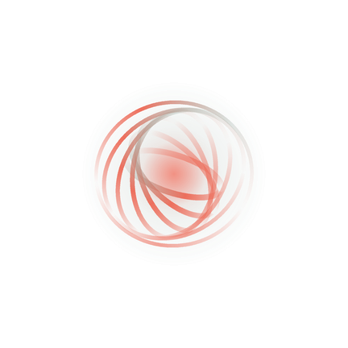
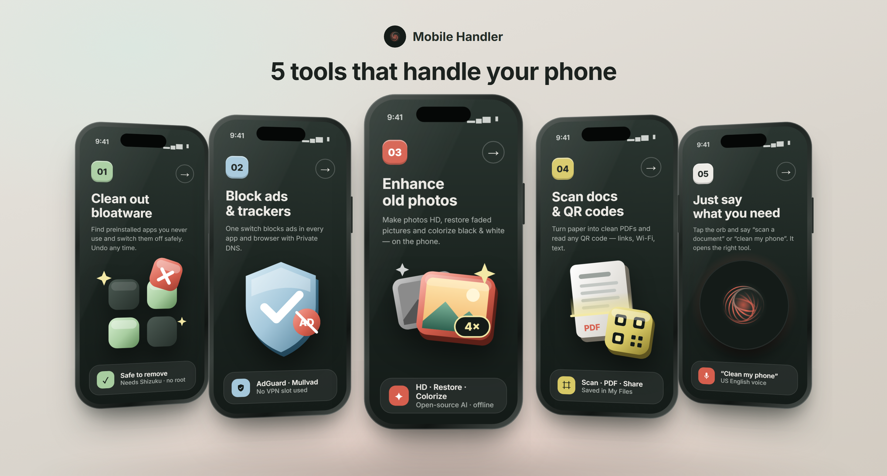
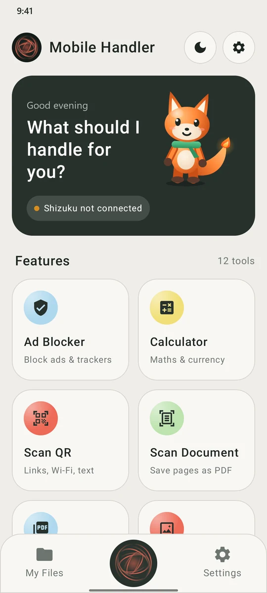
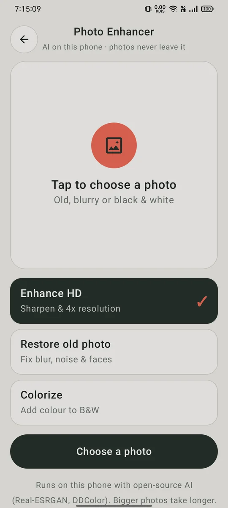
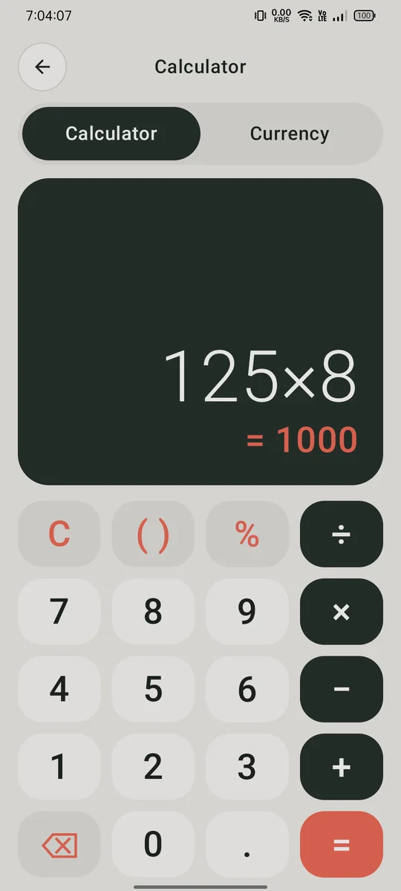

  

<h1 align="center">Mobile Handler</h1>

  One private Android app to clean, protect and handle your phone. 
  <a href="https://janardanpal007.github.io/mobile-handler/"><b>Website</b></a> ·
  <a href="https://github.com/Janardanpal007/mobile-handler/releases/latest/download/MobileHandler.apk"><b>Download APK</b></a> ·
  <a href="https://github.com/Janardanpal007/mobile-handler/releases"><b>All releases</b></a>

  
  
  
  

## What it does

| | Tool | What you get |
|---|---|---|
| 01 | **Phone Cleaner** | Finds preinstalled apps you never use and switches them off safely. Every change can be undone with **Restore Apps**. |
| 02 | **Ad Blocker** | Blocks ads in every app and browser with Android's Private DNS (AdGuard or Mullvad). No VPN slot used. Also finds trackers hidden inside your apps. |
| 03 | **Photo Enhancer** | Makes photos HD (4× resolution), restores old pictures and colorizes black & white ones, on the phone, with open-source AI. |
| 04 | **Scan Document & Scan QR** | Turns paper into clean PDFs and reads any QR code (links, Wi-Fi, text). **Photos → PDF** combines images into one PDF. |
| 05 | **Voice assistant** | Tap the orb and say what you need ("scan a document", "clean my phone") and it opens the right tool. |

Also included: **Calculator** with currency converter, **Weather** (today and 3 days), **My Files** for your scans, PDFs and enhanced photos, and light and dark themes.

## Screenshots

  
  
  

## Private by design

- No sign-up, no ads, no analytics.
- Photos, scans and files are processed on the phone.
- **Private mode** (on by default) keeps the app fully offline.
- Removed apps can always be restored; a factory reset also brings everything back.

## Install

1. On your Android phone, open the [latest release](https://github.com/Janardanpal007/mobile-handler/releases/latest) and download **MobileHandler.apk**.
2. Open the file. If Android asks, allow your browser to install apps.
3. Tap **Install**. Play Protect may warn you because the app isn't from the Play Store; tap **Install anyway**.
4. For Phone Cleaner, install the free [Shizuku](https://shizuku.rikka.app/) app. Mobile Handler walks you through setting it up step by step.

The QR and document scanners come from Google Play services, so the first scan may take a moment while Play services downloads them.

## Requirements

- Android 8.0 or newer (ARM phones)
- Google Play services for the QR and document scanners
- Internet only for weather, currency rates and setup tips (turn off Private mode)

## Credits

Photo AI models: [Real-ESRGAN](https://github.com/xinntao/Real-ESRGAN) and [DDColor](https://github.com/piddnad/DDColor), open source.
Phone Cleaner uses [Shizuku](https://github.com/RikkaApps/Shizuku). Scanners by Google ML Kit.

---

Built by <b>Janardan / TSE</b>

